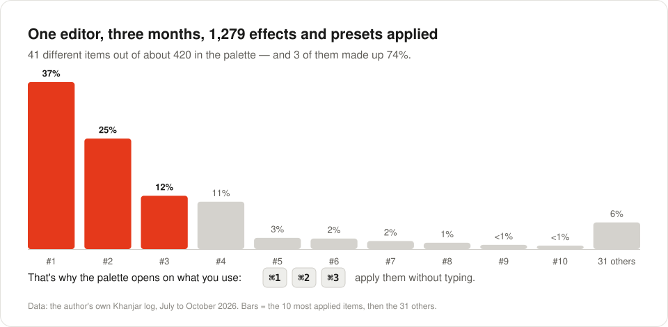
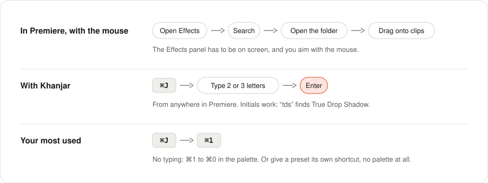
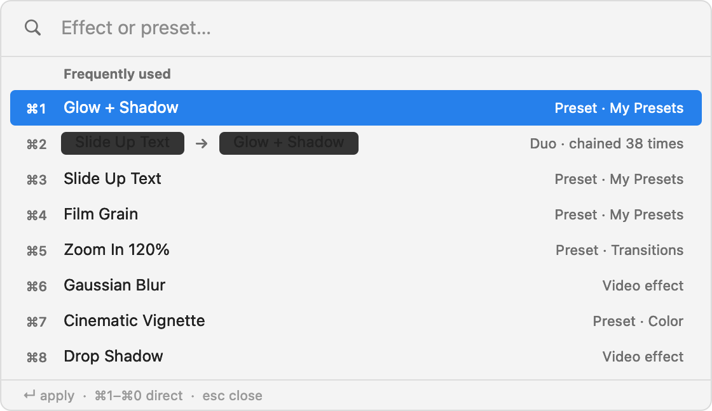
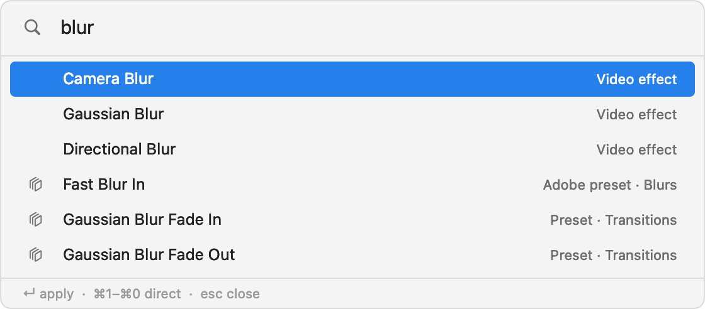
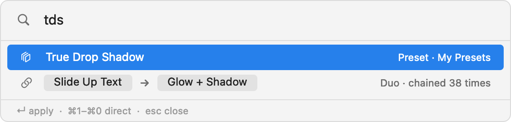
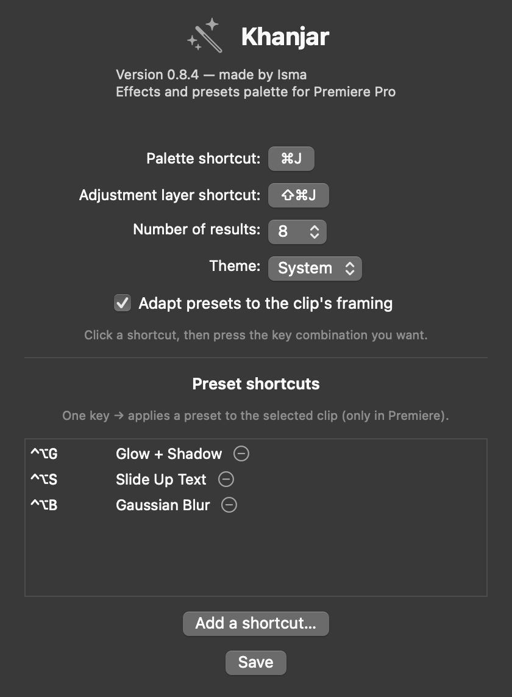
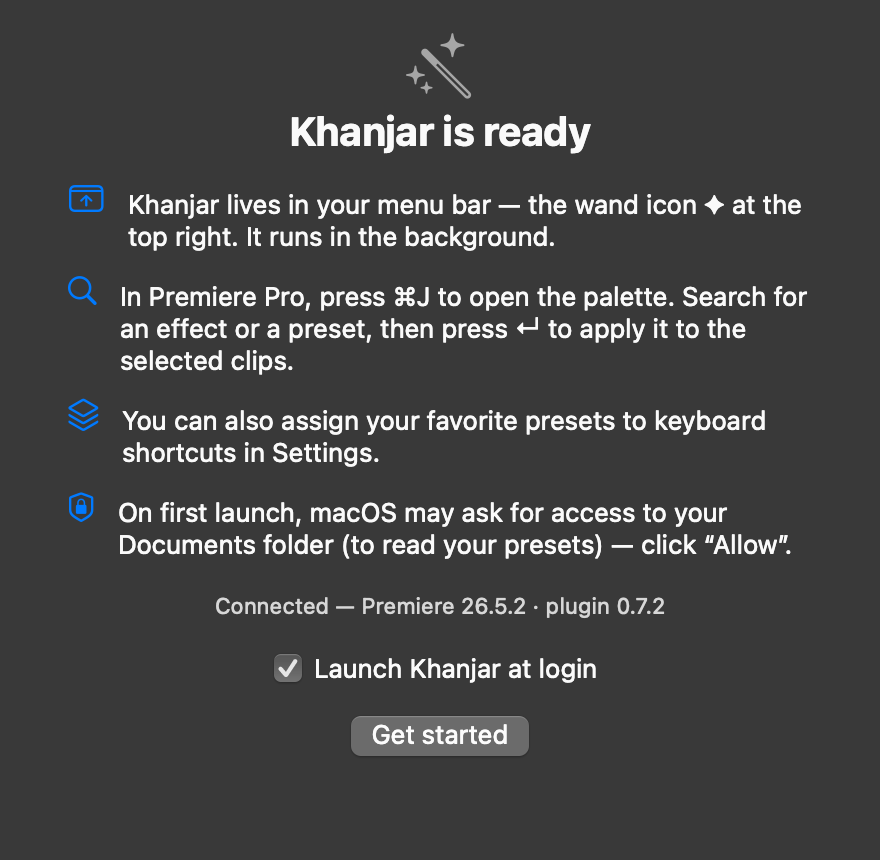
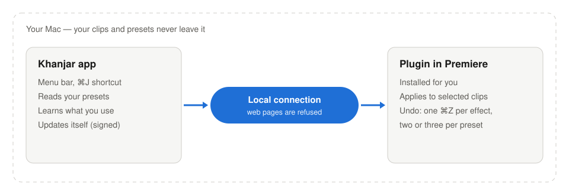

<p align="center">
  
</p>

# Khanjar

**A free command palette for Adobe Premiere Pro on Mac.** Press **⌘J**, type a few letters of any
effect or preset, press **Enter**: it lands on every clip you selected.

No panel to open, no folder to dig through, no mouse. Your most used presets wait at the top of the
palette on ⌘1 to ⌘0, and any preset can get its own keyboard shortcut.

> Free and open source (GPL-3.0) · macOS on Apple Silicon · Premiere Pro 2026 · Beta · Not affiliated
> with Adobe.

<p align="center">
  
</p>

<p align="center"><a href="https://github.com/Apocale/khanjar/releases/latest"><b>Download</b></a> · <a href="docs/INSTALL.md">Install in 3 minutes</a> · <a href="docs/INSTALL.md#install-with-claude-code-easiest">Let Claude Code install it</a> · <a href="docs/INSTALL.fr.md">En français</a> · <a href="https://apocale.github.io/khanjar/">Website</a></p>

*Khanjar* (خنجر) means "dagger" in Arabic, Persian and Urdu. A dagger, because editing is cutting.

## Why it exists

You don't use 420 effects. You use the same few, all day long. Here is what the author applied over
three months of real editing:

<picture>
  <source media="(prefers-color-scheme: dark)" srcset="docs/media/usage-dark.svg">
  
</picture>

So Khanjar opens on what you actually use, ranked by how often *and* how recently you used it.
Press ⌘J and ⌘1 applies your number one. Start typing and it searches everything else.

## The mouse way, or ⌘J

<picture>
  <source media="(prefers-color-scheme: dark)" srcset="docs/media/ways-dark.svg">
  
</picture>

## One stroke, every clip

<p align="center">
  
</p>

Select one clip or 150, press Enter once. Every clip gets the effect, or the whole preset with its
settings and keyframes. Undo stays simple: one ⌘Z for an effect, two or three for a preset, not one
per clip.

## What it looks like

**It opens on what you use most.** ⌘1 to ⌘0 apply an item without typing. When you always chain two
presets on the same clip, Khanjar offers them as one *duo*, stacked the way you apply them.

<picture>
  <source media="(prefers-color-scheme: dark)" srcset="docs/media/palette-frequent-dark.png">
  
</picture>

**It finds things the way you remember them.** A word, half a word, or just the initials.

<table>
  <tr>
    <td><picture><source media="(prefers-color-scheme: dark)" srcset="docs/media/palette-search-dark.png"></picture></td>
    <td><picture><source media="(prefers-color-scheme: dark)" srcset="docs/media/palette-initials-dark.png"></picture></td>
  </tr>
  <tr><td align="center"><code>blur</code></td><td align="center"><code>tds</code> → True Drop Shadow</td></tr>
</table>

**A key for any preset, and a welcome screen that explains the rest.**

<table>
  <tr>
    <td></td>
    <td></td>
  </tr>
</table>

<sub>These screens are drawn by Khanjar itself (<code>khanjar render-media</code>) with example presets.</sub>

## Your presets, wherever they come from

Khanjar reads the presets in your own Premiere: the ones you made, the packs you bought, the ones a
friend sent you. Adobe's presets are there too. Presets saved in a Premiere set to another language
work as well.

Animated presets keep their timing. Keyframes are stretched to the clip, or pinned to its start or
end, the way Premiere does it, and eased curves are rebuilt frame by frame so the motion matches.

And a few more things:

- **⌘⇧J** drops an adjustment layer above your clips, at the playhead.
- **Your own shortcuts**: menu bar icon > *Settings…* > *Add a shortcut…*, pick a preset, press keys.
- **Updates itself**, signed, so only genuine Khanjar releases can install.
- English and French interface.

## Install

**Requirements**: a Mac with **Apple Silicon** (M1 or later) on macOS 13 or later, **Premiere Pro
2026** (26.x) or later, and the **Creative Cloud** desktop app (it installs Khanjar's small plugin
inside Premiere). Tested on macOS 26 with Premiere Pro 26.5.

- Easiest: paste the [Claude Code install prompt](docs/INSTALL.md#install-with-claude-code-easiest)
  ([en français](docs/INSTALL.fr.md#installer-avec-claude-code-le-plus-simple)) and let it do the steps.
- Or download `Khanjar-<version>.zip` from [Releases](https://github.com/Apocale/khanjar/releases/latest)
  and follow the [installation guide](docs/INSTALL.md) ([en français](docs/INSTALL.fr.md)).

The beta is not signed by Apple yet, so macOS asks you to confirm the first launch. The guide shows
how; it takes about a minute, once.

## Honest limits

These come from what Adobe's plugin API allows today:

- Presets that rely on a **mask**, or on Lumetri **curves, color wheels or LUTs**, are left out of the
  palette rather than applied wrong. Lumetri presets that only move sliders (exposure, contrast,
  vignette…) work.
- A preset is marked *partial* when one of its effects no longer exists in your Premiere, or one of
  its settings can't be set through the API. The rest is applied.
- Eased animations are rebuilt frame by frame: the motion matches, but Effect Controls shows one
  keyframe per frame instead of two.
- Khanjar **can't create** an adjustment layer. Make one once in your project (*File > New >
  Adjustment Layer*) and Khanjar reuses it.
- Audio effects and transitions aren't supported yet.

## Privacy

Khanjar runs entirely on your Mac. It talks to Premiere through a local connection that web pages
are not allowed to use. Your clips, projects and presets never leave your computer.

One optional thing uses the internet: **update checks** (Khanjar asks on its second launch, then
reads the list of releases on GitHub). Details: [PRIVACY.md](PRIVACY.md).

## Questions people ask

**Is there a command palette, a Spotlight or a quick search for Adobe Premiere Pro?**
Yes, that is what Khanjar is: press ⌘J in Premiere, type a few letters of any effect or preset,
press Enter.

**How do I apply an effect or a preset to many clips at once in Premiere Pro?**
Select the clips in the timeline, press ⌘J, pick the effect or preset. It lands on every selected
clip in one step, and you undo it with one ⌘Z for an effect, two or three for a preset.

**Can I assign a keyboard shortcut to a preset in Premiere Pro?**
Yes: menu bar icon > *Settings…* > *Add a shortcut…*, choose the preset, press the key combination.
The shortcut works whenever Premiere is in front.

**How do I add an adjustment layer at the playhead with a shortcut?**
Press ⌘⇧J. Create one adjustment layer in your project once; Khanjar reuses it.

**Does it work with the preset packs I bought, or presets made in another language?**
Yes. Khanjar reads your own Premiere *Effect Presets* (where installed packs live) and Adobe's,
including presets saved in a Premiere set to another language. Third-party effects used by a pack
must be installed in your Premiere.

**Do animated presets keep their timing and their easing?**
Yes. Keyframes follow the preset's anchoring (stretched to the clip, or pinned to its start or end),
and eased curves are reproduced frame by frame.

**Which versions of Premiere Pro does it work with?**
Premiere Pro 2026 (26.x) and later, tested on 26.5. Older versions aren't supported.

**Is it free? Does it work on Windows or Intel Macs?**
Free and open source (GPL-3.0). macOS on Apple Silicon only for now.

**Does it slow Premiere down?**
No. Khanjar does nothing until you press a shortcut. An effect is applied in about 5 to 15 ms; a
preset on 283 clips took a third of a second.

**Can an AI assistant install it for me?**
Yes. The [install guide](docs/INSTALL.md#install-with-claude-code-easiest) has a prompt you paste
into Claude Code: it checks your Mac, downloads the latest Khanjar and installs it one step at a time,
asking you before anything that matters.

**How do I uninstall it?**
See [Uninstall](docs/INSTALL.md#uninstall) in the guide: quit Khanjar, move it to the Trash, and
remove its plugin with one command.

## Under the hood

<picture>
  <source media="(prefers-color-scheme: dark)" srcset="docs/media/how-it-works-dark.svg">
  
</picture>

Two processes and a small protocol:

- **`helper/`**: the native Swift app in the menu bar. Global shortcut, palette window, search index,
  preset parsing (`.prfpset`), local WebSocket server.
- **`plugin/`**: a headless UXP plugin inside Premiere. A stateless executor that applies what the app
  asks for, in grouped transactions, so undo never goes clip by clip.

Details: [docs/ARCHITECTURE.md](docs/ARCHITECTURE.md) and [docs/PROTOCOL.md](docs/PROTOCOL.md).
Developer notes, with many hard-won findings about Premiere's UXP API (in French), are in
[AGENTS.md](AGENTS.md).

### Build from source

Requires the Xcode Command Line Tools (Swift 5.9 or later), Python 3 and Node.js (the plugin build
syntax-checks its JavaScript with `node --check`).

```bash
./scripts/build-app.sh        # builds dist/Khanjar.app with the plugin embedded
./scripts/fetch-sparkle.sh    # once, before a plain `swift build` (build-app.sh does it for you)
cd helper && swift build && ./.build/debug/khanjar selftest
```

Updates use [Sparkle](https://sparkle-project.org), downloaded and checksum-verified by
`scripts/fetch-sparkle.sh`. Releases are prepared by `scripts/release.sh`.

## Made by an editor, with AI

Khanjar is made by Isma, a video editor, not a programmer. It was built with Claude Code, an AI
coding assistant: he described what he needed in Premiere, the AI wrote the code, and the features
are tested in a real Premiere, on throwaway projects and in his daily editing.

The rest of this page is made with AI too. The dagger images were generated with GPT Image 2.5, the
diagrams are drawn in code (SVG) by Claude, and the palette screenshots are rendered by Khanjar
itself. The usage chart comes from the author's own Khanjar log.

## En français

Khanjar est une palette gratuite pour Adobe Premiere Pro sur Mac : presse ⌘J, tape quelques
lettres d'un effet ou d'un preset, Entrée, et il s'applique à tous les clips sélectionnés. La palette
s'ouvre sur tes presets les plus utilisés (⌘1 à ⌘0), et tu peux mettre un raccourci clavier sur
n'importe quel preset. Interface en français. Fait par un monteur, avec l'IA.
[Guide d'installation](docs/INSTALL.fr.md).

## Contributing

Bug reports and ideas are welcome: open an [issue](https://github.com/Apocale/khanjar/issues).
See [CONTRIBUTING.md](CONTRIBUTING.md).

## License

[GPL-3.0](LICENSE) · made by Isma, with AI.
